# 🔔 EC2 Monitoring & Alerting Architecture – CloudWatch, SNS, SQS & SES

**Category:** 📊 Monitoring & 📨 Integration – Architecture Lab (AWS Console)

> One alarm, many receivers. AWS watches the server, raises an alert, and delivers it to a support queue, the application owner's inbox and the clients – all from the AWS Console.

---

## 🗺️ Architecture


| Component | Role in this lab |
|-----------|------------------|
| **SQS** | Sub_1 – stores alerts for the **L1 support team** / internal chat app until they are read |
| **SNS Topic** | Receives the alarm and **pushes** one copy to every subscriber (fan-out) |
| **Email** | Sub_2 – sends an instant alert email to the **application owner** |
| **SES (via Lambda)** | Sends a branded email to **client email-ids** |
| **EC2** | Runs the application. Its instance ID, public IP and private IP identify which server raised the alert |
| **CloudWatch** | Collects EC2 metrics and runs an **alarm** (CPU > 80%) |

## 🧠 Real-world Analogy

- **EC2** = the shop counter doing the actual work
- **CloudWatch** = CCTV + supervisor watching the counter all day
- **Alarm** = the rule: "If the queue is too long, raise an alert"
- **SNS Topic** = the office loudspeaker – one announcement, every subscriber hears it at once
- **SQS** = the complaint register – messages wait there until someone reads and closes them
- **SNS Email** = a message to the manager's personal inbox
- **SES** = the company's official letterhead email sent to customers

## ⚖️ Push vs Pull

| | SNS | SQS |
|-|-----|-----|
| Model | **Push** – delivers instantly | **Pull** – consumer must poll |
| Storage | No storage (retries, then drops or sends to DLQ) | Stores messages up to **14 days** (default 4) |
| Receivers | Many (fan-out) | One consumer processes each message |
| Use when | Notify many systems at once | Decouple and buffer work safely |

**Why SNS + SQS together?** SNS gives one-to-many delivery, SQS gives durability. If the L1 support app is down, alerts wait safely in the queue instead of being lost.

## 📧 SNS Email vs SES

| | SNS Email subscription | SES |
|-|------------------------|-----|
| Audience | Internal team | External clients |
| Format | Plain text with AWS footer | Custom subject, HTML, templates |
| Sender | `no-reply@sns.amazonaws.com` | Your verified address or domain |
| Setup | Click "Confirm subscription" | Verify identity; request production access to leave the sandbox |

---

## 🛠️ Lab – Step by Step (AWS Console, Region: Asia Pacific (Mumbai) `ap-south-1`)

### Step 1 – Create the SQS queue

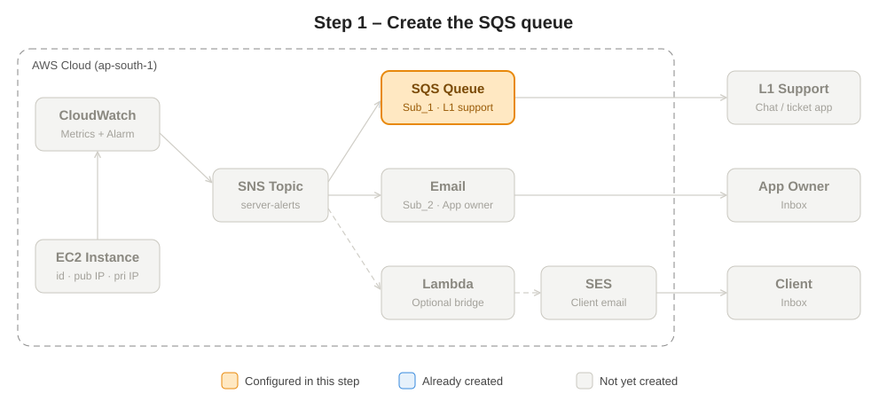

1. Open **Simple Queue Service → Create queue**.
2. Type: **Standard**.
3. Name: `l1-support-queue`.
4. Keep defaults (visibility timeout 30 s, retention 4 days).
5. Click **Create queue**.

> 📌 **Note:** Standard queues give at-least-once delivery and very high throughput. FIFO queues keep strict order and must end with `.fifo`.

### Step 2 – Create the SNS topic

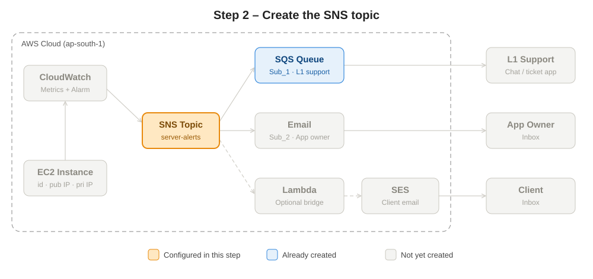

1. Open **Simple Notification Service → Topics → Create topic**.
2. Type: **Standard**.
3. Name: `server-alerts`.
4. Leave other settings default → **Create topic**.
5. Copy the **Topic ARN** for reference.

> 📌 **Note:** Standard topics support all protocols. FIFO topics keep strict order but can deliver only to SQS FIFO queues.

### Step 3 – Sub_1: Subscribe the SQS queue to the topic

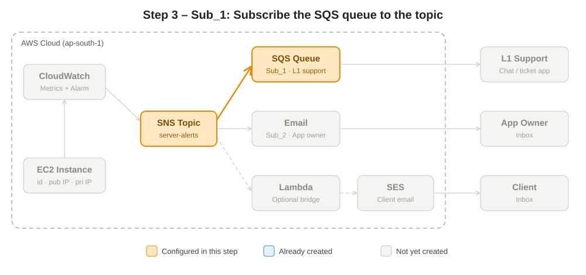

1. Open **SQS → l1-support-queue**.
2. Click **Subscribe to Amazon SNS topic**.
3. Choose `server-alerts` → **Save**.
4. Open **SNS → Topics → server-alerts → Subscriptions** – the SQS subscription is listed with status **Confirmed**.
5. *(Optional)* Select the SQS subscription → **Edit** → enable **Raw message delivery** so the queue receives only the message body without the SNS JSON wrapper.

> 📌 **Note:** Subscribing from the SQS console automatically adds the **access policy** that allows SNS to send messages to the queue. Subscribing from the SNS side requires adding that policy manually, otherwise the queue stays empty.

### Step 4 – Sub_2: Email subscription for the application owner

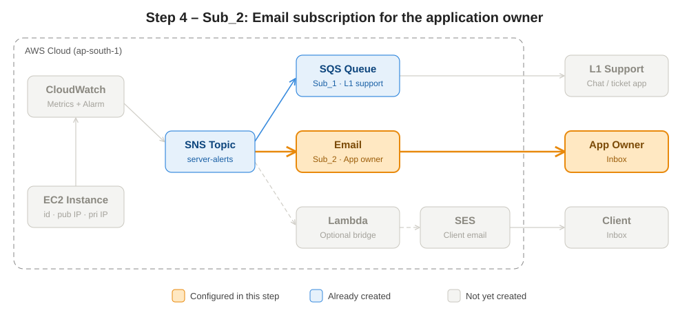

1. Open **SNS → Topics → server-alerts → Create subscription**.
2. Protocol: **Email**.
3. Endpoint: the application owner's email address.
4. **Create subscription** → status shows **Pending confirmation**.
5. Open the inbox → click **Confirm subscription** in the AWS email.
6. Refresh the console → status changes to **Confirmed**.

> 📌 **Note:** Without confirmation, no emails are delivered. Check the spam folder if the confirmation email is missing.

### Step 5 – SES: Verify sender and client email identities

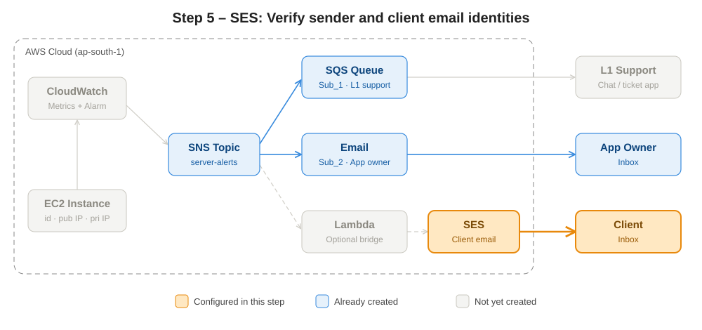

1. Open **Amazon SES → Configuration → Identities → Create identity**.
2. Identity type: **Email address** → enter the sender address (e.g. `alerts@yourcompany.com`) → **Create identity**.
3. Click the verification link in that inbox → status becomes **Verified**.
4. Repeat for the **client** email address (required while in the sandbox).
5. Select the sender identity → **Send test email** → To: client address → Subject: `Service Alert` → Body: a short message → **Send test email**.
6. To email any client without verifying them, go to **Account dashboard → Request production access**.

> 📌 **Note:** New SES accounts are in the **sandbox** – emails can be sent only to verified addresses with low daily limits. In production, verify a whole **domain** (DKIM records) instead of single emails.

### Step 6 – Optional: Lambda bridge from SNS to SES

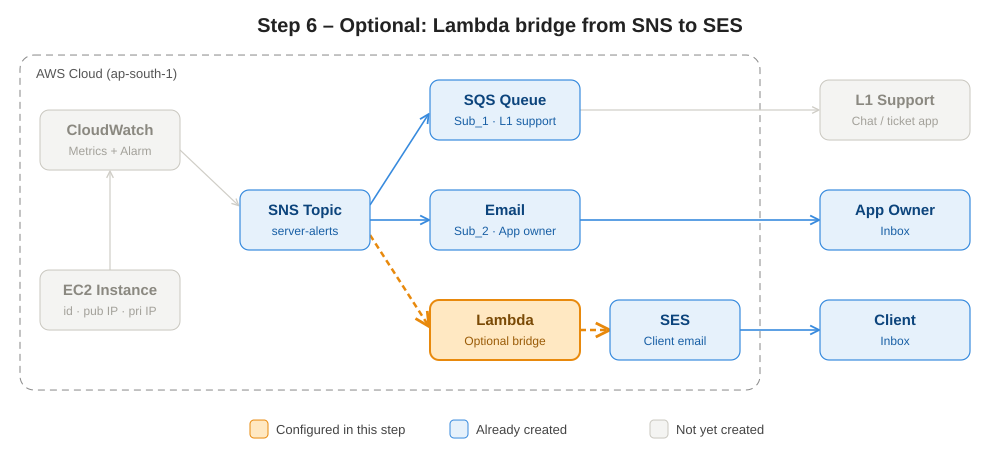

SNS cannot send through SES directly, so a Lambda function subscribed to the topic sends the client email.

1. Open **Lambda → Create function → Author from scratch**.
2. Name: `alert-to-client`; Runtime: **Python 3.12** → **Create function**.
3. Paste this code in the editor → **Deploy**:
   ```python
   import boto3, json

   ses = boto3.client("ses", region_name="ap-south-1")

   def lambda_handler(event, context):
       alarm = json.loads(event["Records"][0]["Sns"]["Message"])
       ses.send_email(
           Source="alerts@yourcompany.com",
           Destination={"ToAddresses": ["client@example.com"]},
           Message={
               "Subject": {"Data": f"Alert: {alarm['AlarmName']} is {alarm['NewStateValue']}"},
               "Body": {"Text": {"Data": f"Hi,\n\n{alarm['NewStateReason']}\n\n– Support Team"}},
           },
       )
       return {"statusCode": 200}
   ```
4. **Configuration → Permissions** → click the execution role → **Add permissions → Attach policies** → add a policy allowing `ses:SendEmail` (for the lab, `AmazonSESFullAccess`).
5. Back in the function → **Add trigger → SNS** → topic `server-alerts` → **Add**.

> 📌 **Note:** In production, follow least privilege – give the role only `ses:SendEmail` on the specific identity, not full access.

### Step 7 – Launch the EC2 instance

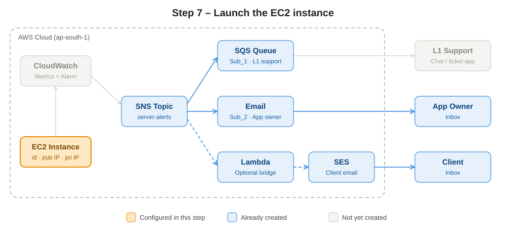

1. Open **EC2 → Instances → Launch instances**.
2. Name: `alert-demo-server`; AMI: **Amazon Linux 2023**; Instance type: `t2.micro` / `t3.micro` (Free Tier eligible).
3. Select or create a **key pair**.
4. Network settings → Security group: allow **SSH (22)** from **My IP**.
5. Click **Launch instance**.
6. Open the instance → **Details** tab and note the **Instance ID**, **Public IPv4** and **Private IPv4**.
7. *(Optional)* **Actions → Monitor and troubleshoot → Manage detailed monitoring** → enable for 1-minute metrics (extra cost).

> 📌 **Note:** By default EC2 sends CPU, network and disk I/O metrics every 5 minutes. **Memory and disk-space %** are not included – they need the **CloudWatch Agent**.

### Step 8 – Create the CloudWatch alarm on EC2 CPU

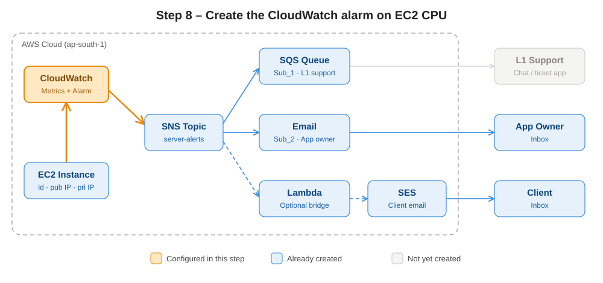

1. Open **CloudWatch → Alarms → All alarms → Create alarm**.
2. **Select metric → EC2 → Per-Instance Metrics** → search the Instance ID → tick **CPUUtilization** → **Select metric**.
3. Statistic: **Average**; Period: **5 minutes**.
4. Threshold type: **Static** → **Greater than** → `80` → **Next**.
5. Notification → Alarm state trigger: **In alarm** → **Select an existing SNS topic** → `server-alerts`.
6. *(Optional)* **Add notification** → state **OK** → same topic, to get a recovery notification.
7. **Next** → Alarm name: `high-cpu-alert-demo-server` → **Next** → **Create alarm**.

> 📌 **Note:** Alarm states are **OK**, **ALARM** and **INSUFFICIENT_DATA**. A new alarm starts in INSUFFICIENT_DATA until enough data points arrive.

### Step 9 – Trigger the alarm and verify the email

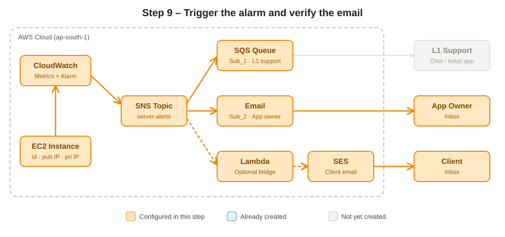

1. Select the instance → **Connect → EC2 Instance Connect → Connect**.
2. Generate CPU load:
   ```bash
   sudo dnf install -y stress-ng
   stress-ng --cpu 2 --timeout 600
   ```
3. Open the instance's **Monitoring** tab and watch CPU rise.
4. In **CloudWatch → Alarms**, wait for the state to change to **In alarm** (5–10 minutes).
5. Check the application owner's inbox – the alert email arrives with the alarm name, reason and instance ID.
6. If Step 6 is completed, the client also receives the SES email.

> 📌 **Note:** One alarm delivers a copy to the email, the SQS queue and the Lambda at the same time – this is the **fan-out pattern**.

### Step 10 – Read the alert message from SQS

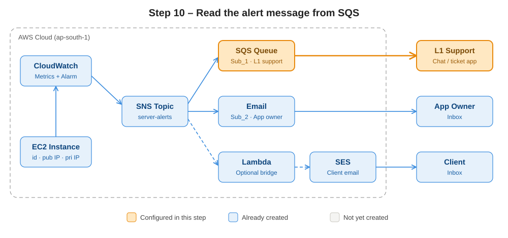

1. Open **SQS → l1-support-queue → Send and receive messages**.
2. Under **Receive messages** click **Poll for messages**.
3. Click the message ID → **Body** tab to read the alarm details.
4. After handling the issue, select the message → **Delete**.
5. Internal chat test (S → R): type text in **Send message → Message body** → **Send message**, then poll again to receive it.

> 📌 **Note:** A message that is not deleted reappears after the **visibility timeout** (30 s), so consumers must delete messages after processing.

### Step 11 – Clean up

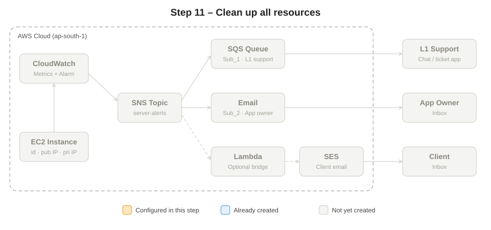

Delete in this order to avoid charges and dependency errors:

1. **CloudWatch → Alarms** → select `high-cpu-alert-demo-server` → **Actions → Delete**.
2. **EC2 → Instances** → select the instance → **Instance state → Terminate instance**.
3. **Lambda** → select `alert-to-client` → **Actions → Delete**.
4. **SES → Identities** → select each identity → **Delete**.
5. **SNS → Topics** → select `server-alerts` → **Delete** (its subscriptions are removed too).
6. **SQS** → select `l1-support-queue` → **Delete**.

---

## 🔑 Key Concepts Summary

**SQS:** Standard vs FIFO; visibility timeout; long polling (up to 20 s); Dead Letter Queue; message size up to 256 KB; retention 1 minute to 14 days; access policy.

**SNS:** Standard vs FIFO topics; protocols – Email, SMS, SQS, Lambda, HTTP/HTTPS, mobile push; subscription filter policies; raw message delivery.

**SES:** sandbox vs production; email and domain identities (DKIM, SPF); templates; bounce and complaint monitoring.

**CloudWatch:** metrics, namespaces (`AWS/EC2`), dimensions (`InstanceId`), basic (5 min) vs detailed (1 min) monitoring, alarm states, alarm actions (SNS, Auto Scaling, EC2 stop/reboot/recover), CloudWatch Agent for memory and logs.

## 🩺 Troubleshooting

| Problem | Check |
|---------|-------|
| No email received | Subscription still **Pending confirmation**? Check spam folder |
| SQS queue empty after alarm | Queue access policy allows SNS? Subscribe from the SQS console to add it automatically |
| Alarm stuck in INSUFFICIENT_DATA | Correct instance selected? Instance running? Wait one full period |
| No memory metric | Install the CloudWatch Agent |
| SES email rejected | Account in sandbox – verify the recipient or request production access |
| Messages keep coming back in SQS | Consumer didn't delete the message before the visibility timeout |

## ❓ Interview Questions

1. **SNS vs SQS?** SNS is push-based pub/sub with no storage; SQS is a pull-based queue that stores messages.
2. **What is the fan-out pattern?** One SNS topic delivers the same message to multiple subscribers that each process it independently.
3. **Why put SQS behind SNS?** Durability and decoupling – messages wait if the consumer is down.
4. **Standard vs FIFO queue?** Standard: at-least-once, best-effort order, high throughput. FIFO: strict order, exactly-once processing.
5. **What is visibility timeout?** The time a received message stays hidden from other consumers while it is processed.
6. **What is a Dead Letter Queue?** A queue that collects messages that failed processing after the maximum receive count.
7. **How do you monitor EC2 memory?** Install the CloudWatch Agent.
8. **What are CloudWatch alarm states?** OK, ALARM, INSUFFICIENT_DATA.
9. **SNS email vs SES?** SNS email is a simple internal notification; SES is a full email service for branded external emails.
10. **What is the SES sandbox?** Default restricted mode allowing sends only to verified addresses with low limits.

## 📝 Practice

- Complete Steps 1–10 and confirm the alarm reaches both the email inbox and the SQS queue.
- Add a Dead Letter Queue to `l1-support-queue` with **Maximum receives = 3**.
- Complete Step 6 so clients also receive an SES email.
- ⚠️ Delete or stop resources after the lab to avoid charges.

---
📜 © 2026 Senthil – TrainerStacks. Licensed under [CC BY-NC-ND 4.0](LICENSE). For personal learning only.
